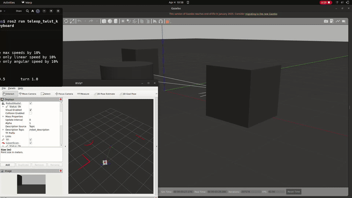

# Autobot: Virtual Prototyping of a Differential-Drive Robot (ROS 2 + Gazebo)

**Built and simulated a two-wheeled robot with LIDAR, camera and depth-camera sensors entirely in software, so it could be driven and tested before any hardware exists.**



## Problem
Physical robot prototypes are slow and expensive to iterate on. Can a full robot (body, wheels, sensors, controls) be modelled and tested in simulation first?

## What we built
- **Robot model:** "autobot", a differential-drive robot defined in URDF/Xacro (chassis, wheels, caster, mass and inertia).
- **Sensors:**
  - 2D LIDAR, visualised as laser scans in RViz
  - standard camera
  - depth camera
- **Control:** keyboard teleoperation (`teleop_twist_keyboard`) driving the wheels through the Gazebo diff-drive plugin.
- **Worlds:** an empty world and an obstacle course for testing the sensors.

## Result
The robot spawns in Gazebo, drives on keyboard commands, and streams live LIDAR and camera data to RViz (see `demo/`). The work is written up as a 4-page IEEE-style paper.

## Tools
ROS 2, Gazebo, RViz, URDF/Xacro, Python launch files, Ubuntu (Oracle VirtualBox VM)

## My role
Team of 4 students with a faculty guide (B.Tech CSBS, Semester 6, 2025). I worked across robot modelling, sensor integration and testing, and co-authored the paper.

## Credits
The ROS package started from the Articulated Robotics `my_bot` template (Apache 2.0, licence included in `code/my_bot/`). The paper acknowledges this.

## Folder contents
| Path | What it is |
|---|---|
| `paper/Autobot_ROS2_Simulation_Paper.pdf` | Project paper (4 pages) |
| `demo/autobot_simulation_demo.mp4` | 53-second screen recording of the robot being driven, with LIDAR and camera views |
| `demo/autobot_demo.gif` | 8-second clip |
| `demo/autobot_screenshot.png` | Still frame |
| `code/my_bot/` | ROS 2 package: robot description, sensors, launch files, worlds |

## How to run
On Ubuntu with ROS 2 and Gazebo installed:
```bash
cd ~/ros2_ws/src && cp -r <this folder>/code/my_bot .
cd ~/ros2_ws && colcon build --symlink-install && source install/setup.bash
ros2 launch my_bot launch_sim.launch.py
ros2 run teleop_twist_keyboard teleop_twist_keyboard   # in a second terminal
```

## Licence

The ROS package in `code/my_bot/` is Apache 2.0 (see its `LICENSE.md`), inherited from the Articulated Robotics template.

---
**Shubham Tanna** · ROS 2, Gazebo, RViz, URDF/Xacro
<!-- SITE_LINK:work -->
